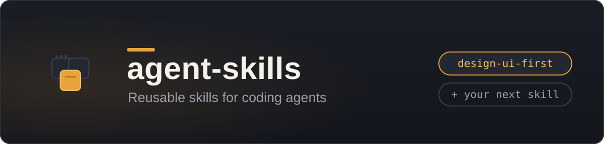

# Agent Skills

  

A collection of reusable workflows for coding agents. Each skill lives at `skills/<name>/SKILL.md` and can be installed individually.

| Skill | When to use it |
|---|---|
| [design-ui-first](skills/design-ui-first/SKILL.md) | Define user needs, research visual references, compare layouts, and choose a direction before implementing a screen. |

## Install

Use Node.js 22.20 or later. For a private repository, run the installer on a machine with read access through Git credentials, GitHub CLI, or SSH. From the consumer project, run:

~~~sh
npx skills add glennprays/agent-skills --list
npx skills add glennprays/agent-skills --skill design-ui-first -a codex
~~~

The Codex target installs to `.agents/skills/` in the project. OMP also scans this directory when project discovery is enabled. For access across projects on the same machine, use the global scope:

~~~sh
npx skills add glennprays/agent-skills --skill design-ui-first -a codex -g
~~~

Global installation uses `~/.agents/skills/`. Open a fresh OMP session and try:

> Use design-ui-first to design a family search screen. Show me two options before implementation.

For Hermes or Kiro CLI, select `-a hermes-agent` or `-a kiro-cli` on the machine where the agent runs.

## Add or update a skill

1. Create `skills/<name>/SKILL.md`. Use a lowercase, hyphenated name that matches the frontmatter. Explain when the agent should use the skill in its description.
2. Add a catalog entry and an example request. Verify discovery and installation from a local checkout.
3. To revise an existing skill, edit its folder and merge the change into the distribution branch. From the consumer project, check for updates and install the revision:

~~~sh
npx skills check
npx skills update design-ui-first
~~~

Discover new skills with `--list` and install them with `--skill <name>`. Teams using project installations should handle `skills-lock.json` according to their consumer repository's policy.

## References

[Agent Skills specification](https://agentskills.io/specification) · [Vercel Skills CLI](https://github.com/vercel-labs/skills) · [OMP skill discovery](https://github.com/can1357/oh-my-pi/blob/main/docs/skills.md)
