# Agent Skills

  

A collection of reusable workflows for coding agents. Each skill lives at `skills/<name>/SKILL.md` and can be installed individually.

The Craft Raven carries a seed of reusable knowledge: agents bring capability; skills bring practiced judgment.

| Skill | When to use it |
|---|---|
| [design-ui-first](skills/design-ui-first/SKILL.md) | Define user needs, research visual references, compare layouts, and choose a direction before implementing a screen. |
| [agent-ready-repo](skills/agent-ready-repo/SKILL.md) | Set up or tidy a repo's agent system — memory, tasks, handoffs, decisions, stack playbooks, harness pointers — and reconcile recorded state against git. |
| [second-opinion](skills/second-opinion/SKILL.md) | Get an independent review, track findings across sessions, and verify requested fixes against an identified baseline. |
| [flight-director](skills/flight-director/SKILL.md) | Shape a direction, make explicit decisions, and guide work as evidence changes while the executor keeps its session. |

## Install

Prerequisites: Node.js 22.20 or later. Run the installer from the root of the consumer project, on a machine with read access to this private repository through Git credentials, the GitHub CLI, or SSH. To see what is available without installing anything:

~~~sh
npx --yes skills add glennprays/agent-skills --list
~~~
Replace `--skill design-ui-first` with `--skill agent-ready-repo` (or any catalog skill name) in any command below.

### Claude Code

~~~sh
npx --yes skills add glennprays/agent-skills --skill design-ui-first -a claude-code -y
~~~

Installs to `.claude/skills/` in the project.

### OMP (Oh My Pi)

~~~sh
npx --yes skills add glennprays/agent-skills --skill design-ui-first -a codex -y
~~~

The `codex` target deliberately selects the shared `.agents/skills/` project directory, not the Codex application. OMP discovers skills installed there when `skills.enableAgentsProject: true`. Restart OMP in the consumer project, then ask it to read `skill://design-ui-first` and report the resolved file path — depending on the OMP version it may resolve the skill file itself or the `SKILL.md` inside it.

### Codex

~~~sh
npx --yes skills add glennprays/agent-skills --skill design-ui-first -a codex -y
~~~

Installs to `.agents/skills/` in the project.

### OpenCode

~~~sh
npx --yes skills add glennprays/agent-skills --skill design-ui-first -a opencode -y
~~~

Installs to `.agents/skills/` in the project.

### Other agents

| Agent | Project install command | Project discovery root |
|---|---|---|
| Cursor | `npx --yes skills add glennprays/agent-skills --skill design-ui-first -a cursor -y` | `.agents/skills/` |
| Gemini CLI | `npx --yes skills add glennprays/agent-skills --skill design-ui-first -a gemini-cli -y` | `.agents/skills/` |
| Hermes | `npx --yes skills add glennprays/agent-skills --skill design-ui-first -a hermes-agent -y` | `.hermes/skills/` |
| Kiro CLI | `npx --yes skills add glennprays/agent-skills --skill design-ui-first -a kiro-cli -y` | `.kiro/skills/` |

For further supported agents, see the [installer's agent registry](https://github.com/vercel-labs/skills/blob/main/docs/agents.md).

### Multiple agents and global installs

Repeat `-a` to install for several agents in one run:

~~~sh
npx --yes skills add glennprays/agent-skills --skill design-ui-first -a claude-code -a codex -a opencode -y
~~~

Project scope is the default. Agents that share `.agents/skills/` share the installed skill; the command above also makes the skill discoverable to Claude Code under `.claude/skills/` (the installer may copy or link the files).

For access across projects on the same machine, add `-g`:

~~~sh
npx --yes skills add glennprays/agent-skills --skill design-ui-first -a claude-code -g -y
~~~

This installs to the user root, `~/.claude/skills/` for Claude Code (configured Claude home overrides apply); each agent has its own user root — see the [supported-agent docs](https://github.com/vercel-labs/skills/blob/main/docs/agents.md). For OMP, prefer the project instructions above: a global `.agents/skills` alone does not guarantee discovery, because foreign user providers are opt-in via `enabledProviders` ([OMP discovery docs](https://github.com/can1357/oh-my-pi/blob/main/docs/skills.md)).

### Try it

Restart or reopen the chosen agent in the consumer project, then try:

> Use design-ui-first to explore two request inspector layouts. Show me the options before implementation.

> Use second-opinion to investigate this from the evidence independently.

After a requested fix:

> Recheck finding F-01 in the same case against the current change.

> Use flight-director to shape this date-filter idea and hand it to my existing executor.

Installing the files does not guarantee every agent or model follows the workflow identically.

## Add or update a skill

1. Create `skills/<name>/SKILL.md`. Use a lowercase, hyphenated name that matches the frontmatter. Explain when the agent should use the skill in its description.
2. Add a catalog entry and an example request. Verify discovery and installation from a local checkout.
3. To revise an existing skill, edit its folder and merge the change into the distribution branch. From the consumer project, check for updates and install the revision:

~~~sh
npx skills check
npx skills update design-ui-first
~~~

Discover new skills with `--list` and install them with `--skill <name>`. Teams using project installations should handle `skills-lock.json` according to their consumer repository's policy.

## References

[Agent Skills specification](https://agentskills.io/specification) · [Vercel Skills CLI](https://github.com/vercel-labs/skills) · [Skills CLI reference](https://github.com/vercel-labs/skills/blob/main/docs/commands.md) · [OMP skill discovery](https://github.com/can1357/oh-my-pi/blob/main/docs/skills.md)
